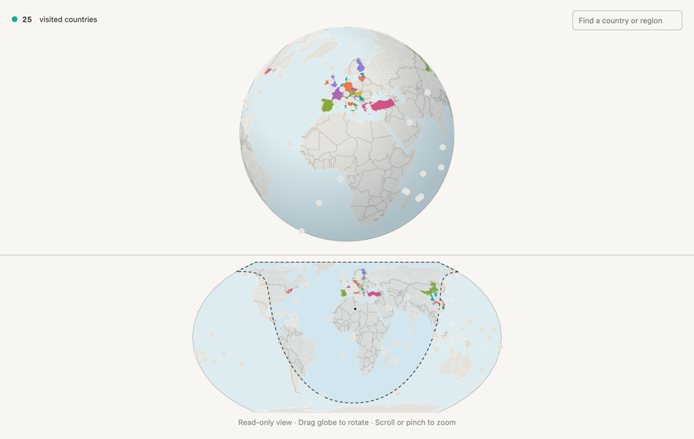

# Chao Ni

I work on the machine learning side of robotics, building humanoids at Hexagon.

[Email](mailto:nichao.dev@gmail.com) · [LinkedIn](https://www.linkedin.com/in/chao-ni-27593518b/) · [Website](https://chaofiber.github.io/)

MSc Robotics, ETH Zurich · BSc Mechanics and BSc Economics, Peking University

## Travel map

<a href="https://chaofiber.github.io/travel-map/?readonly"><picture><source media="(prefers-color-scheme: dark)" srcset="assets/travel-map-dark.png"></picture></a>

An interactive, read-only map of the countries and regions I have visited.
